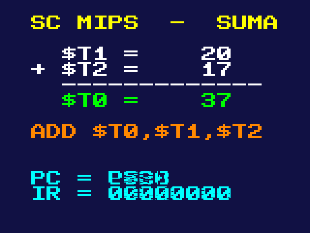

# VGA_MIPS_Suma — Single-cycle MIPS + VGA on the DE10-Lite

The single-cycle MIPS from `Activities/07_SC_MIPS` runs `add $t0,$t1,$t2` and the
result is drawn as text on a VGA monitor (640x480 @ 60 Hz).

## Files

| File | What it is |
|------|-----------|
| `vga_mips_suma.v` | **Top level**: slow CPU clock, reset button, MIPS, text screen, VGA output |
| `SC_MIPS.v`, `RegisterFile.v`, `InstructionMemory.v`, `PC.v` | Copies of 07_SC_MIPS with small changes marked `// NUEVO` |
| `ALU.v`, `ALUControl.v`, `ControlUnit.v`, `Adder.v` | Unchanged copies of 07_SC_MIPS |
| `imdata`, `rfdata` | Same program and initial registers as 07_SC_MIPS (5 + 3) |
| `vga_sync.v` | Same VGA timing module as `VGA_Frame` |
| `font_rom.v` | 8x8 letters (generated by `tools/make_font.py`) |
| `bin2dec.v` | Binary → decimal digits (double dabble) |
| `vga_mips_suma_tb.v`, `sim.do` | ModelSim simulation; writes `frame_sim.ppm` |

## Board controls

| Control | Function |
|---------|----------|
| `SW9..SW5` | First operand → `$t1` (0–31, binary) |
| `SW4..SW0` | Second operand → `$t2` (0–31, binary) |
| `KEY0` (hold ~1 s) | Loads the switches into `$t1`/`$t2` and sets PC = 0 |
| `LEDR9..LEDR0` | `$t0` in binary |

At power-on the registers come from `rfdata`, so the screen shows **5 + 3 = 8**.
The CPU runs at ~3 Hz, so you can watch `PC` and `IR` change on the screen.
